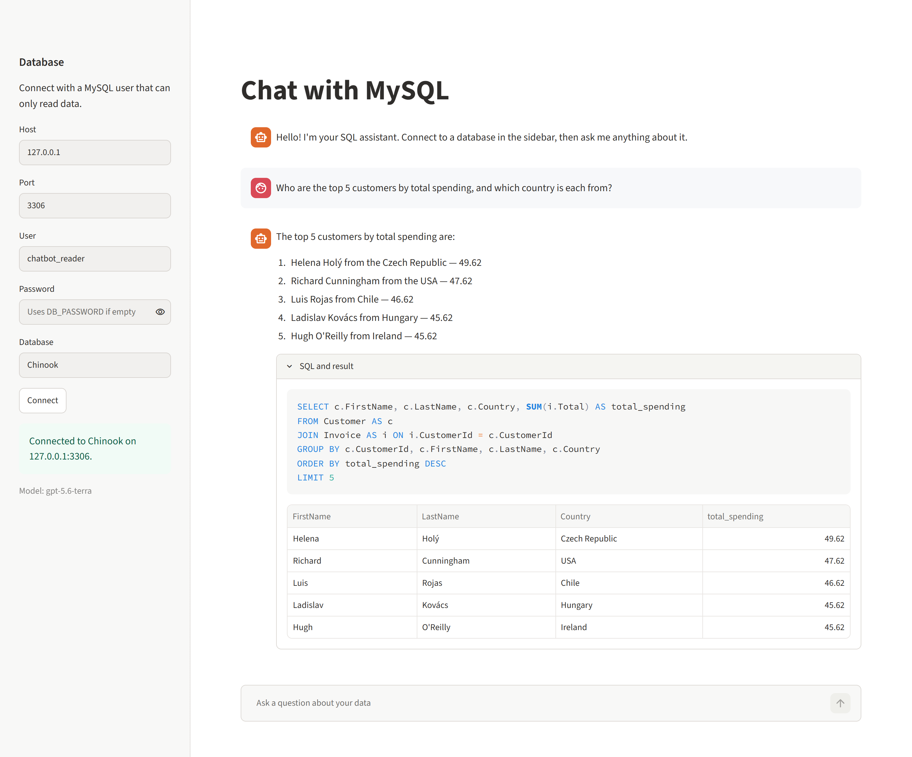

# Chat with your database

[](https://github.com/aryanonline/SQL-chatbot/actions/workflows/ci.yml)

Ask a MySQL database questions in plain English and get answers that show the SQL and rows behind them.



## What it does

- A Streamlit chat with a connection form in the sidebar (host, port, user, password,
  database).
- For each question, an OpenAI model writes one MySQL `SELECT` from the schema, the recent
  conversation and your question. The app checks that the query only reads data, runs
  it, and a second model call turns the result into a plain-English answer.
- Under each answer, a **SQL and result** panel shows the generated query and up to 200
  rows of its result.
- Follow-up questions work: the last 10 chat messages are sent along with each question.
- If MySQL rejects the query (a misspelled column, for example), the model gets one more
  try with the error message.
- Queries that are not a single read-only `SELECT` are refused before they reach the
  database (see [Safety](#safety)).

## How it works

```
question + last 10 chat messages + schema (read once, when you connect)
   │
   ▼
1. SQL step ─── the model writes one MySQL query
   │
   ▼
2. Guard ────── one read-only SELECT? ── no ──► not run; the reason is shown
   │ yes
   ▼
3. MySQL ────── READ ONLY transaction, 15 s time limit, at most 200 rows kept
   │    │
   │    └── database error ──► back to step 1 once, with the query and the error
   │                           (a second error is shown to the user)
   ▼
4. Answer step ─ the model explains the result in plain English
   │
   ▼
answer in the chat + "SQL and result" panel
```

1. **SQL step** (`sql_chat/chains.py`). The prompt holds the schema, the last 10 chat
   messages, the question and two worked examples written for the
   [Chinook](https://github.com/lerocha/chinook-database) sample database. The schema
   text comes from LangChain's `SQLDatabase.get_table_info()`: a `CREATE TABLE`
   statement and three sample rows per table. It is read once at connect time.
2. **Guard** (`sql_chat/guard.py`). Strips markdown fences and trailing semicolons from
   the model's reply, then parses the SQL with `sqlparse` and rejects anything that is
   not a single read-only `SELECT`. A rejected query is shown but never run or retried.
3. **Execution** (`sql_chat/db.py`). The app runs the query itself through SQLAlchemy, in
   a read-only transaction with a time limit and a row cap, and always rolls back.
4. **Answer step** (`sql_chat/chains.py`). A second prompt gets the question, the SQL
   and the rows (with a note when there were more than 200) and writes the reply.

## Tech stack

Runtime versions are pinned in `requirements.txt`; development tools in
`requirements-dev.txt`.

| Package | Version | Used for |
| --- | --- | --- |
| Python | 3.12, 3.13 | both tested in CI |
| streamlit | 1.67.0 | chat UI |
| langchain-core | 1.8.1 | prompts and chains |
| langchain-openai | 1.8.0 | OpenAI chat model (`gpt-5.6-terra` by default) |
| langchain-community | 0.4.2 | `SQLDatabase`, for the schema text |
| SQLAlchemy | 2.1.8 | connection pool, URL building, query execution |
| mysql-connector-python | 26.10.0 | MySQL driver |
| sqlparse | 0.6.1 | parsing for the read-only guard |
| python-dotenv | 1.2.4 | loading `.env` |
| pytest / ruff | 9.2.0 / 0.17.5 | tests / lint and formatting |
| MySQL (Docker) | 8.4 | local demo database |

## Quick start

You need Python 3.12 or 3.13 and an OpenAI API key. Option A also needs Docker.

### A. Demo database in Docker (Chinook)

1. Clone the repository and create your `.env`:

   ```bash
   git clone https://github.com/aryanonline/SQL-chatbot.git
   cd SQL-chatbot
   cp .env.example .env
   ```

   In `.env`, set `OPENAI_API_KEY`, `MYSQL_ROOT_PASSWORD` and `READER_PASSWORD` (choose
   your own passwords; `docker compose` refuses to start without them).

2. Download the Chinook MySQL script (release v1.4.5, 616,450 bytes) into `docker/init/`:

   ```bash
   curl -L -o docker/init/00-chinook.sql https://github.com/lerocha/chinook-database/releases/download/v1.4.5/Chinook_MySql.sql
   ```

   In Windows PowerShell, type `curl.exe` instead of `curl`.

3. Start MySQL and wait until the service shows as `healthy`:

   ```bash
   docker compose up -d
   docker compose ps
   ```

   On the first start, MySQL loads Chinook (`00-chinook.sql`) and then
   `docker/init/01-reader.sh` creates `chatbot_reader`, a user that can only `SELECT`
   from the `Chinook` database. The port is bound to `127.0.0.1` only.

4. Install the app and start it:

   ```bash
   python -m venv .venv
   source .venv/bin/activate        # Windows: .venv\Scripts\activate
   pip install -r requirements.txt
   streamlit run app.py
   ```

5. In the sidebar, host, port, user (`chatbot_reader`) and database (`Chinook`) are
   filled in from `.env`. Type your `READER_PASSWORD` (or set `DB_PASSWORD` in `.env` to
   fill it in too), click **Connect** and ask a question.

The init scripts run only when the data volume is empty. If you added the Chinook file
after the first start, or the first start failed, reset the database with
`docker compose down -v` (this deletes the volume) and run `docker compose up -d` again.

### B. Your own MySQL server

1. Copy `.env.example` to `.env` and set `OPENAI_API_KEY`. The `DB_*` values are
   optional defaults for the connection form; the `MYSQL_*` and `READER_PASSWORD` values
   are only for Docker.
2. Create a user that can only read, for the host the app connects from:

   ```sql
   CREATE USER 'chatbot_reader'@'localhost' IDENTIFIED BY 'choose-a-strong-password';
   GRANT SELECT ON your_database.* TO 'chatbot_reader'@'localhost';
   ```

3. Install and start the app as in step 4 above, then enter your server's details in
   the sidebar and click **Connect**.

## Configuration

The app reads its settings from environment variables and from a `.env` file in the
project folder; variables already set in the environment take precedence. Restart the
app after changing `.env`.

| Variable | Default | Read by | Purpose |
| --- | --- | --- | --- |
| `OPENAI_API_KEY` | none (required) | app | OpenAI API key. Without it the app shows a message instead of the chat. |
| `OPENAI_MODEL` | `gpt-5.6-terra` | app | Chat model for both steps. |
| `DB_HOST` | `127.0.0.1` | app | Default host in the connection form. |
| `DB_PORT` | `3306` | app | Default port. |
| `DB_USER` | empty | app | Default user. |
| `DB_PASSWORD` | empty | app | Default password. Leave empty to type it in the sidebar. |
| `DB_NAME` | `Chinook` | app | Default database. |
| `MYSQL_ROOT_PASSWORD` | none (required) | `docker compose` | Root password of the demo database. |
| `READER_PASSWORD` | none (required) | `docker compose` | Password for `chatbot_reader`. |
| `MYSQL_PORT` | `3306` | `docker compose` | Port on `127.0.0.1` for the demo database. Keep `DB_PORT` the same. |

## Example questions (Chinook)

- Which 3 artists have the most tracks?
- How many customers are there in each country?
- What were total sales by year?
- Which genre has the longest average track length?
- Who are the top 5 customers by total spend? Then: which countries are they from?

## Safety

The model writes SQL and the app runs it, so the app checks the SQL in two places:

1. **Guard, before the query is run** (`sql_chat/guard.py`). The query must be exactly
   one statement of type `SELECT` (`WITH ... SELECT` is fine). It is rejected if, outside
   string literals, comments and quoted identifiers, it contains any of `INSERT`, `UPDATE`,
   `DELETE`, `REPLACE`, `MERGE`, `DROP`, `CREATE`, `ALTER`, `TRUNCATE`, `RENAME`, `GRANT`,
   `REVOKE`, `CALL`, `DO`, `HANDLER`, `LOAD`, `LOCK`, `UNLOCK`, `SET`, `INTO`, `OUTFILE`
   or `DUMPFILE` (function calls such as `REPLACE(Name, 'a', 'b')` are allowed); if it
   refers to the functions `SLEEP`, `BENCHMARK` or `LOAD_FILE`; or if it has a MySQL
   executable comment (`/*! ... */`) or an optimizer hint (`/*+ ... */`). The guard errs
   on the side of refusing, so some harmless queries are refused too.
2. **Database, while the query runs** (`sql_chat/db.py`). Each query runs in a
   `START TRANSACTION READ ONLY` transaction that is always rolled back, with
   `MAX_EXECUTION_TIME` set to 15 seconds and `sql_select_limit` set so MySQL sends at
   most 201 rows. The app keeps 200 and tells the model when the result was cut off.

Neither layer replaces database permissions: always connect with a read-only user, like
the `chatbot_reader` user the Docker setup creates. Do not point this app at a
production database with a user that can write.

Credentials: nothing is hardcoded, and the password field starts empty unless
`DB_PASSWORD` is set. The connection URL is built with SQLAlchemy's `URL.create`, so
special characters in passwords are escaped. Connection errors show the error type and
the driver's message, never the password.

## Testing

```bash
pip install -r requirements-dev.txt
ruff check .
ruff format --check .
pytest -q
```

The tests need no MySQL, OpenAI key or network: in-memory SQLite stands in for MySQL and
LangChain's `FakeListChatModel` for OpenAI. They cover the guard (tables of allowed and
rejected SQL), URL escaping, the row cap, the order of the MySQL session statements
(against a fake connection), the chain (answer, retry after a database error, guard
rejection without running the query, history trimming) and the Streamlit UI through
`streamlit.testing.v1.AppTest`. GitHub Actions runs the same commands on Python 3.12 and
3.13 for every push to `main` and every pull request.

## Project structure

```
app.py                      Streamlit UI (the entry point)
sql_chat/
  config.py                 settings from the environment and .env
  chains.py                 the two model steps, the retry and history trimming
  guard.py                  read-only SQL check
  db.py                     connection, schema text, read-only query execution
tests/                      pytest suite (no MySQL, OpenAI or network needed)
compose.yaml                MySQL 8.4 demo database
docker/init/01-reader.sh    creates the read-only chatbot_reader user
.github/workflows/ci.yml    lint and tests on Python 3.12 and 3.13
requirements.txt            pinned runtime dependencies
requirements-dev.txt        runtime dependencies plus pytest and ruff
pyproject.toml              ruff and pytest settings
.env.example                every setting, with placeholders
```

## Limitations

- **The whole schema goes into every question.** The SQL step gets every table's
  definition and sample rows, so a database with many tables can exceed the model's
  context window, and every question costs more.
- **Answers can be wrong.** The model can misread a question or write SQL that runs but
  answers something else. Check the SQL in the **SQL and result** panel.
- **OpenAI costs and data.** Each question makes two model calls (three when the retry
  is used). OpenAI receives the schema with sample rows, the last 10 chat messages and
  up to 200 result rows per question.
- **MySQL only.** The connection URL and the read-only session statements are written
  for MySQL; MariaDB and other databases are not supported.
- **At most 200 rows** per result reach the answer and the panel.
- **langchain-community is being sunset** by LangChain (importing it raises a
  `DeprecationWarning`). The app uses it only to build the schema text.
